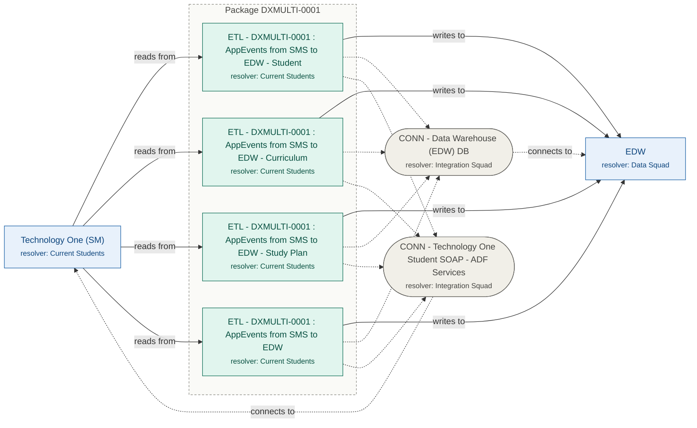

# Observability CMDB

The Jira Assets side of the observability stack, as **one service** (`cmdb`) that does two jobs:

| Job | How | Who / how often |
|---|---|---|
| **Enrichment API** (always running) | `GET /ci/{ci_name}` returns the CI's resolver group, root CI, who to inform and the impact, read from Jira Assets | Keep, for every alert. Day to day. |
| **Setup and admin commands** (run inside the service) | `cmdb preflight / plan / apply / lookup / validate` keep Jira Assets in line with the definitions in this repo | You or the Jira team. Once for setup, then when the structure changes. |

```
schemas/*.yaml + data/*.csv ──cmdb apply──▶ Jira Assets ◀── cmdb service ◀── GET /ci/{ci_name} ── Keep / curl
```

- **What's defined:** three Jira Assets schemas, *Applications*, *Connectors* and *Integrations*, in
  `schemas/*.yaml`. Their objects are in `data/*.csv`, loaded once from the Integrations SOT.
- **Part of a three-repo setup:**
  - [observability-env-simulator](https://github.com/diegodss/observability-env-simulator): the systems being monitored;
  - [observability-platform](https://github.com/diegodss/observability-platform): Prometheus, Grafana, alerting, and Keep later;
  - this repo.

## Quick start (3 steps)

The CMDB is already set up in the dev Jira (`nextbitfx-dev.atlassian.net`). To run the API against it,
you need Docker and an Atlassian account with read access to the Applications, Connectors and
Integrations Assets schemas.

```bash
# 1. Clone and configure: set JIRA_EMAIL and JIRA_API_TOKEN in .env (everything else is pre-filled)
git clone https://github.com/diegodss/observability-cmdb.git && cd observability-cmdb && cp .env.example .env

# 2. Start
docker compose up -d --build

# 3. Try it
curl -H "Authorization: Bearer local-dev-cmdb-key" http://localhost:8090/ci/EDW
```

Expected in step 3:
- `"resolver_group": "Data Squad"` and `"impact": {"count": 4, …}`, listing the 4 DXMULTI-0001
  integrations;
- `"routing": {"project": "OPS", "labels": ["resolver-data-squad"], …}`.

API token: https://id.atlassian.com/manage-profile/security/api-tokens. `local-dev-cmdb-key` is the
static development key from `.env.example`; use a real secret anywhere shared (see "Security and
caching").

## What's in the CMDB

The CIs and their relationships. Arrows show the data flow: source system → integration → target
system. Dotted lines are connectors: an integration uses a connector, which connects to an
application. The box around the integrations is their **Integration Package**, one per integration ID.

<!-- diagram:start (generated by `cmdb diagram` from data/*.csv; do not edit by hand) -->

<!-- diagram:end -->

| Colour / shape | Object type (schema) |
|---|---|
| Blue box | Application (Applications) |
| Green box | Integration (Integrations) |
| Grey pill | Connector (Connectors) |
| Box around integrations | Integration Package (Integrations) |

**Regenerating:** after changing `data/*.csv`, run `docker compose exec cmdb cmdb diagram` and paste
the output between the markers above.

**In Jira Assets:**
- **The whole picture:** open **DXMULTI-0001** (the Integration Package) and its graph. It shows all
  member integrations, both systems and the connectors in one view, because the package links to
  each of them directly.
- **Elsewhere:** the graph shows the selected object's direct relationships; expand a node to follow
  the chain further.

**Integration Package.** One per integration ID, parsed from the integration names (e.g. `DXMULTI-0001`).
- **Derived, not maintained:** its Source System, Target System, Connector CIs and Resolver Group
  (when all members share one) are **derived** from its integrations by `initial-load`.
- **Kept honest:** `validate`, which also runs before `plan`/`apply`, flags any package that no
  longer matches.
- **Lookup:** `GET /ci/DXMULTI-0001` returns the package with its member integrations as impact.

## Run the service

```bash
cp .env.example .env        # set JIRA_EMAIL, JIRA_API_TOKEN (a read-only account is enough);
                            # the rest is pre-filled for the dev site
docker compose up -d --build
```

Endpoints:
- from your machine: `http://localhost:8090`;
- from other containers on the shared Docker network `observability-sim`: `http://cmdb:8080`.

The container is named `observability-cmdb`.

### Try it

```bash
export CMDB_API_KEY=local-dev-cmdb-key     # the static dev key from .env.example

curl http://localhost:8090/health
# {"status":"ok","backend":"jira","auth":true,"cache_seconds":60.0}

curl -H "Authorization: Bearer $CMDB_API_KEY" http://localhost:8090/ci/EDW
```

```json
{
  "found": true,
  "ci":      {"name": "EDW", "type": "Application", "schema": "Applications", "key": "APP-2", "status": "Production", "resolver_group": "Data Squad"},
  "root_ci": {"name": "EDW", "type": "Application", "schema": "Applications", "key": "APP-2", "status": "Production", "resolver_group": "Data Squad"},
  "resolver_group": "Data Squad",
  "informed_groups": ["Current Students"],
  "routing": {"resolver_group": "Data Squad", "mode": "label", "project": "OPS", "labels": ["resolver-data-squad"]},
  "impact": {
    "count": 4,
    "domains": ["Current Students / Student Enrolment"],
    "integrations": [
      {"name": "ETL - DXMULTI-0001 : AppEvents from SMS to EDW", "direction": "writes to", "resolver_group": "Current Students",
       "status": "Production", "domain": "Current Students", "subdomain": "Student Enrolment",
       "source_system": "Technology One (SM)", "target_system": "EDW"}
    ]
  },
  "details": {"aliases": "EDW (SVC_IDM) | EDW(DI_SMS_EDW) | EDW (di_edw_cms) | EDW / StudentOne", "hosting": ""},
  "enrichment": {"backend": "jira", "at": "2026-10-24T07:30:00+00:00", "lookups": 3, "cached": false}
}
```

The example shows one of the four integrations. An integration CI works the same way; URL-encode the name:

```bash
curl -H "Authorization: Bearer $CMDB_API_KEY" "http://localhost:8090/ci/ETL%20-%20DXMULTI-0001%20%3A%20AppEvents%20from%20SMS%20to%20EDW%20-%20Student"
# resolver_group: Current Students, root_ci: the integration itself, impact: 1

curl -H "Authorization: Bearer $CMDB_API_KEY" "http://localhost:8090/ci/ETL%20-%20DXMULTI-0001%20%3A%20AppEvents%20from%20SMS%20to%20EDW%20-%20Student?failed_side=target"
# root_ci: EDW, resolver_group: Data Squad, informed: Current Students, impact: 4
```

### API

| Endpoint | Response |
|---|---|
| `GET /health` | `{"status": "ok", "backend": "jira", "auth": true, "cache_seconds": 60}`. No key needed (for health checks) |
| `GET /ci/{ci_name}` | enrichment JSON (above). **401** without a valid key; **404** with `"found": false` for an unknown CI; **502** if Jira is unreachable |
| `GET /ci/{ci_name}?failed_side=source\|target` | for an integration CI: treat its source or target application as the root CI, with that application's impact |

Root CI rules:
- **Application:** itself. The impact is every integration that reads from or writes to it.
- **Connector:** itself. The impact is every integration whose Connector CIs include it.
- **Integration:** itself, unless `failed_side` is given.

### Ticket routing

Incidents are ordinary Jira issues; Jira Service Management isn't needed. Each response carries a
`routing` block saying where the ticket goes for the root CI's resolver group. The mapping lives in
`data/routing.yaml`, so Keep never hard-codes it:

```yaml
default_project: OPS      # placeholder: your real project key
label_prefix: resolver-
groups:
  Current Students: {project: }
  Data Squad: {project: }
  Integration Squad: {project: }
```

| Stage | Setting | Ticket goes to |
|---|---|---|
| **Now: labels** | `project:` empty | `default_project`, labelled `resolver-data-squad`, `resolver-current-students`, … (`"mode": "label"`) |
| **Later: a project per squad** | e.g. `Current Students: {project: CS}` | that squad's own project, still labelled (`"mode": "project"`) |

- **Switching is one line per squad, with no code change.** Keep creates the issue in
  `routing.project` with `routing.labels`, whichever mode is set.
- **Picked up without a restart:** the file is read on each lookup, so edits are live. Responses
  already in the cache keep their old routing for up to `CMDB_CACHE_SECONDS`.
- **Checked:** `cmdb validate` checks that every resolver group used in `data/*.csv` is listed, and
  that project keys are valid.

### Security and caching

**API key.** When `CMDB_API_KEY` is set, every `/ci` request must send it, as
`Authorization: Bearer <key>` or `X-API-Key: <key>`, or it gets 401. `/health` stays open.
- **Development:** `.env.example` ships a static key, `local-dev-cmdb-key`, so local setups work out
  of the box. It's public (it's in this repo), so treat it as no protection at all.
- **Shared or production:** replace it with a secret, e.g. `openssl rand -hex 32`, set as the
  container's `CMDB_API_KEY` secret and shared only with callers (Keep).
- **Empty key:** the API is unauthenticated. The service logs a warning at start-up.

**Why it matters.** The API reads Jira with its own service account and returns your integration
landscape: systems, resolver groups, dependencies. Without the key, anyone who can reach the port
gets that, plus the account's read access.
- **Locally,** the port is bound to `127.0.0.1` only.
- **In production,** don't publish the port at all: Keep reaches it on the internal network. Put it
  behind your gateway if anything outside needs it.

**Cache.** Each CI's response (per `failed_side`) is cached for `CMDB_CACHE_SECONDS` (default 60).
- **Why:** a burst of alerts for the same CI makes one round of Jira queries (3–9 AQL calls) instead
  of one per alert, which keeps the service clear of Atlassian's API rate limits.
- **What it shows:** `"cached": true` in `enrichment` marks a cached response. `lookups` is the number
  of Jira queries made when the response was built.
- **Trade-off:** changes made in Jira show up within that many seconds. Set `0` to disable; errors
  are never cached.

### From the observability platform (Keep)

Platform containers call `http://cmdb:8080/ci/{ci_name}` with the API key, where `ci_name` is the
label every Prometheus alert carries. The stacks can start in any order. Give Keep the key as a
secret. A Keep workflow step looks roughly like this (check the syntax against your Keep version):

```yaml
- name: enrich-from-cmdb
  provider:
    type: http
    with:
      method: GET
      url: "http://cmdb:8080/ci/{{ alert.labels.ci_name }}"
      headers:
        Authorization: "Bearer {{ secrets.CMDB_API_KEY }}"
```

The ticket templates in the platform repo (`docs/incident-templates.md`) take their **Resolver**,
**Impact**, **Domain** and **Flow** values from this response.

## Setup and admin commands

Run them **inside the running service**: one container for everything.

```bash
docker compose exec cmdb cmdb preflight     # with Compose
docker exec -it observability-cmdb sh       # or a shell in the container (any platform), then:
cmdb preflight
```

| Command | What it does |
|---|---|
| `cmdb validate` | Offline check of `schemas/*.yaml`, `data/*.csv` and `data/routing.yaml` |
| `cmdb preflight` | **Read-only.** Checks Jira access, schema keys, cross-schema references and that every resolver group exists (✓ / ✗ each) |
| `cmdb plan` | **Read-only.** Prerequisites, then what `apply` would create or update (`-v` also lists what's in place) |
| `cmdb apply` | Re-checks the prerequisites, shows the plan, **asks to confirm**, then creates or updates. Never deletes. `--yes` skips the prompt |
| `cmdb lookup NAME [--failed-side target] [--json]` | The same enrichment as the API, printed as a table, for checking a CI by hand |
| `cmdb initial-load SOT_CSV` | Regenerates `data/*.csv` from the Integrations SOT. Once only; see below |

### Permissions: read-only for the service, admin only for `apply`

The running service only reads, so give it a **read-only** Jira account in `.env`. `apply` needs
**Assets admin** rights. Pass an admin token for that one command, so the long-running service never
holds admin rights:

```bash
docker compose exec -e JIRA_EMAIL=admin@example.com -e JIRA_API_TOKEN=<admin-token> cmdb cmdb apply
```

On other platforms, use `docker exec -it -e ... observability-cmdb cmdb apply`. You can also use one
account for both while testing.

### First-time setup in a new Jira

1. **Create the resolver groups** in admin.atlassian.com → your site → Directory → Groups:
   `Current Students`, `Data Squad`, `Integration Squad`. They must exist before `apply`, which refuses
   to run while one is missing.
2. **`cmdb preflight`**, then **`cmdb plan`**: both read-only, so you can review before anything changes.
3. **`cmdb apply`** (admin token). It creates the 3 schemas, statuses, reference types, object types
   and attributes.
4. **Enable "Allow others to select objects from this schema"** on **Applications** and
   **Connectors**: in Assets, open the schema → Schema configuration → General.
   - Integrations and Connectors point to objects in those schemas, and Jira rejects such references
     while the setting is off.
   - The tool asks for it at creation, but Jira may ignore that, and the API doesn't allow changing it
     later.
   - While it's off, `apply` stops before creating any objects, and `preflight` marks it ✗.
5. **`cmdb apply`** again. It continues where it stopped and creates the 9 objects.
6. **`cmdb plan`** should report `0 create, 0 update`, and
   `curl -H "Authorization: Bearer $CMDB_API_KEY" http://localhost:8090/ci/EDW` should return Data Squad
   with 4 affected integrations.

The full checklist for the Jira team is in [docs/jira-team-handover.md](docs/jira-team-handover.md).

### Changing things later

- **Objects** (a new resolver group, a renamed CI, …) are edited in **Jira Assets**, which is the
  source of truth after the first `apply`.
- **Structure** (new attributes, types, schemas) goes in `schemas/*.yaml`, then `cmdb plan` and
  `cmdb apply`.
- **Schema names, keys and attribute names** are placeholders that can be renamed to the
  organisation's standard. Edit the YAML before the first `apply`.
- **An existing application type:** if the CMDB already has one, point the reference attributes in
  `connectors.yaml` and `integrations.yaml` at it, and drop `schemas/applications.yaml`.

### Initial load from the SOT (once)

`data/*.csv` are generated from the Integrations SOT and the scope files in `data/initial-load/`:
- which integrations to load;
- application aliases;
- resolver groups;
- which connectors are CIs.

```bash
docker compose run --rm --no-deps -v "/folder/with/the/sot:/input:ro" cmdb initial-load "/input/Integrations SOT(Integrations).csv"
```

After the first `apply`, re-running this and `apply` would overwrite edits made in Jira for the same
objects. Only use it to add **new** integrations, with just those in the scope files. The SOT file is
internal and isn't in this repo.

## Configuration

Settings are environment variables: `.env` locally, or the container's environment (with the token
as a secret) on a platform.

| Setting | Required | Notes |
|---|---|---|
| `JIRA_SITE` | yes | pre-filled with the dev site, `https://nextbitfx-dev.atlassian.net` |
| `JIRA_EMAIL`, `JIRA_API_TOKEN` | yes | read-only account for the service; admin only for `apply` |
| `CMDB_BACKEND` | no | `jira` (default) or `mock` (read the local `data/*.csv`; no Jira needed) |
| `ASSETS_WORKSPACE_ID` | recommended | the Assets workspace. When empty it's discovered through a Jira Service Management API call, so set it to depend only on the Assets API. `cmdb preflight` prints the ID when it has to discover it |
| `CMDB_API_KEY` | yes | key callers send on `/ci` requests. `.env.example` has the static dev key `local-dev-cmdb-key`; use a secret outside local development |
| `CMDB_CACHE_SECONDS` | no | per-CI response cache (default 60; `0` disables) |
| `CMDB_HOST_PORT` | no | host port of the API (default 8090) |

### Running without Docker Compose

The image is self-contained: code, schemas and data are baked in, it starts the API by default, and
it provides the `cmdb` command.

```bash
docker build -t observability-cmdb .
docker run -d --name observability-cmdb -p 127.0.0.1:8090:8080 --env-file .env observability-cmdb   # the API
docker exec -it observability-cmdb cmdb plan                                                        # admin commands
docker run --rm -it --env-file .env observability-cmdb plan                                         # or a one-off container
```

Without Docker (Python 3.12):

```bash
python -m venv .venv && .venv/bin/pip install -r requirements.txt
.venv/bin/python -m cmdb serve --port 8090
.venv/bin/python -m cmdb plan
```

When run this way, settings are read from `.env` in the repo root. The image's baked-in `schemas/` and
`data/` are the ones from the build: rebuild after changing them, or mount newer copies at
`/srv/schemas` and `/srv/data`, as `compose.yaml` does.

## Tests

```bash
docker compose run --rm --no-deps --entrypoint pytest cmdb
```

The tests run against an in-repo fake of the Assets API (`tests/fake_assets.py`) and cover:
- definitions;
- `plan` and `apply`, including idempotency and single-attribute updates;
- the prerequisite gate and confirmation;
- descriptions too long for Jira;
- disabled cross-schema references;
- the Jira and mock backends giving identical enrichment;
- the HTTP API, including the API key (401 without it, both header styles, open `/health`) and the
  per-CI cache.

The real-Jira path was verified end to end against a live Jira Cloud site: `apply`, a second `plan`
with no changes, and the lookups above.

## Layout

```
schemas/                 the 3 schema definitions (structure as code)
data/                    objects per type (CSV), generated by initial-load
data/routing.yaml        where tickets go per resolver group (label now, project later)
data/initial-load/       scope files for the one-off SOT load
cmdb/model.py            loads and validates schemas + data
cmdb/assets.py           Jira Assets REST client (every endpoint used)
cmdb/provision.py        preflight, plan, apply
cmdb/directory.py        CI reads from Jira or from the local files (mock)
cmdb/enrich.py           resolver group, root CI, impact
cmdb/server.py           the HTTP API
tests/                   fake Assets API + tests
docs/jira-team-handover.md
```
